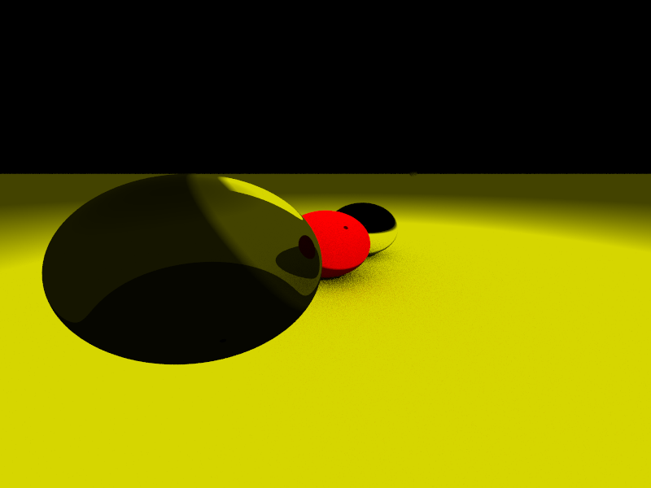

# RustyTracer

A Rust path tracer with a native Metal GPU backend for Apple silicon and a
multithreaded CPU reference renderer. Scenes describe cameras, infinite planes,
spheres, and diffuse, metal, glass, or emissive materials using JSON.

## Quick start on Mac

Use Rust 1.99.1, pinned in `rust-toolchain.toml`. Rust 1.88.0 is also supported.
The GPU backend requires Apple silicon and macOS 15 or newer; hardware ray
traversal requires an M3 or newer GPU. Other supported systems use the CPU.

```sh
rustup toolchain install 1.99.1 --profile minimal --component clippy --component rustfmt
rustup run 1.99.1 cargo run --release --locked -- --list-devices
rustup run 1.99.1 cargo run --release --locked -- \
  --backend metal --width 1920 --height 1080 --samples 256 \
  --output output/metal.png
```

Run commands from the repository root. Explicit `rustup run` commands also work
when Homebrew's Cargo comes first on `PATH`. Release builds are essential for
meaningful CPU timings. Metal shaders are embedded in the executable, compiled at
backend initialization, and reused with the pipelines and scene buffers.

For development and offline shader checking, install Xcode and its Metal toolchain:

```sh
xcodebuild -downloadComponent metalToolchain
python3 scripts/check_shaders.py
```

## Render options

```sh
rustup run 1.99.1 cargo run --release --locked -- --help
```

| Option | Default | Purpose |
| --- | --- | --- |
| `--backend auto/cpu/metal` | `auto` | Select the renderer; auto prefers a compatible Apple GPU |
| `--traversal auto/linear/hardware` | `auto` | Choose GPU intersection strategy |
| `--scene PATH` | `worlds/closed_room.json` | Input scene |
| `--output PATH` | `output/image.png` | PNG or JPEG output; existing files are replaced |
| `--width`, `--height` | `200`, `100` | Image dimensions |
| `--samples` | `5000` | Samples per pixel |
| `--seed` | `1` | Reproducible random streams |
| `--max-bounces` | `64` | Maximum path length, from 1 to 256 |
| `--batch-size` | `32` | GPU samples per dispatch, from 1 to 1024 |
| `--threadgroup-size` | `128` | GPU threads per group; must match pipeline limits and SIMD width |
| `--progress` | off | Report completed GPU sample batches |
| `--benchmark N` | `1` | Number of timed renders with reused backend resources |
| `--warmup N` | `0` | Untimed warm-up renders before timed runs |
| `--metrics PATH` | unset | Save workload settings and detailed timing as JSON |
| `--list-devices` | off | Print compatible GPU capabilities |

Automatic GPU traversal uses direct analytic intersection below 64 spheres and
Metal acceleration structures from 64 spheres on supported GPUs. Infinite planes
are intersected analytically in both modes. Hardware traversal preserves exact
sphere geometry through custom intersection functions. Explicit hardware mode
requires at least one sphere. `--backend cpu --traversal linear` selects the
reference renderer; hardware traversal requires Metal.

With `auto`, an unavailable compatible GPU selects the CPU. Shader compilation,
allocation, and execution errors are reported as errors. Output directories are
created automatically. Missing scenes and invalid settings return readable errors
and a nonzero exit status.

## Performance

Measured on an M4 Pro MacBook Pro with a 12-core CPU, 16-core GPU, 24 GiB unified
memory, macOS 27.0.1, and Rust 1.99.1 release builds. Each median includes PNG
encoding and uses three sequential timed renders after one warm-up render.

| Workload | Baseline | Accelerated | Speedup |
| --- | ---: | ---: | ---: |
| Original room, 1920 x 1080, 256 samples | CPU: 18.693 s | Metal linear: 0.874 s | 21.4x |
| 4,096 spheres, 256 x 144, 16 samples | Metal linear: 0.4253 s | Metal hardware: 0.00359 s | 118.4x |

The second row measures the benefit of acceleration structures within the GPU
backend. The first render including backend setup took 18.579 s on CPU and
0.977 s on Metal. OS and driver shader caches may already have been warm.
CPU calculations use f64, while Metal uses f32; both use matching sample counts,
seeds, bounce limits, materials, and the original path termination rule.

Full measurements are committed in
[`benchmarks/m4-pro-2026-10-19.json`](benchmarks/m4-pro-2026-10-19.json).

Reproduce the primary workload with each backend:

```sh
rustup run 1.99.1 cargo build --release --locked
./target/release/rustytracer --backend cpu --width 1920 --height 1080 \
  --samples 256 --seed 1 --benchmark 3 --warmup 1 \
  --output target/cpu.png --metrics target/cpu.json
./target/release/rustytracer --backend metal --traversal linear \
  --width 1920 --height 1080 --samples 256 --seed 1 --benchmark 3 --warmup 1 \
  --output target/metal.png --metrics target/metal.json
```

The metrics distinguish backend setup, render wall time, GPU command execution,
image conversion/encoding, first-render total, median, and p95. Warm-up renders
are excluded from the timed median. PNG encoding runs after GPU completion.

Generate sphere scenes and benchmark all traversal modes sequentially:

```sh
python3 scripts/benchmark.py
python3 scripts/tune_metal.py
```

The benchmark script uses seed 42 and writes raw metrics, images, generated scenes,
and a summary under `target/performance`. Dense-scene cases compare GPU linear
and hardware traversal; the CPU comparison is performed for the original room.
The tuning script sweeps nine batch/threadgroup combinations. On this machine,
the sweep varied by less than 2%, so the balanced 32-sample, 128-thread defaults
are retained. Timings depend on scene geometry, workload size, GPU contention,
and thermal state.

## Scene format

The existing JSON format is preserved; `worlds/closed_room.json` is a complete
example. Positions, normals, and colors contain exactly three finite numbers.
Colors are nonnegative, sphere radii are positive, and plane normals are nonzero
and normalized by the loader. Camera field of view is vertical, in degrees,
strictly between 0 and 180. Its view direction must be nonzero and not parallel
to its Y up vector.

Materials are `flat`, `metal`, `glass` (index 1.5), and `diffuse_light`. Unknown
material names retain the original flat fallback. The Metal adapter checks f32
range and rejects camera directions that collapse at GPU precision. Very large
coordinates and delicate intersections can differ from the f64 CPU renderer.
Changing a renderer's resolution requires constructing a new renderer.

## Development and verification

```sh
rustup run 1.99.1 cargo fmt --all -- --check
rustup run 1.99.1 cargo clippy --locked --all-targets --all-features -- -D warnings
rustup run 1.99.1 cargo clippy --locked --all-targets --no-default-features -- -D warnings
rustup run 1.99.1 cargo test --locked --all-features
rustup run 1.99.1 cargo test --locked --no-default-features
python3 scripts/check_shaders.py
```

Eight dedicated GPU tests require a real Apple GPU, with M3 or newer for hardware
traversal. Run them explicitly on the Mac:

```sh
MTL_DEBUG_LAYER=1 MTL_SHADER_VALIDATION=1 \
  rustup run 1.99.1 cargo test --locked --all-features -- \
  --ignored --test-threads=1 --nocapture
```

These tests exercise actual GPU RNG streams, CPU/GPU image agreement, all material
types, inside/tangent/missing/nonunit rays, total internal reflection, empty and
tiny scenes, deterministic batch accumulation, buffer reuse, and invalid dispatch
settings. The room test measured mean absolute linear-radiance error of about
0.000006 against the f64 CPU reference. Floating-point tolerances are tested
before clipping or image encoding.

CI builds and tests CPU configurations on Linux, macOS, and Windows, including
Rust 1.88 on Linux. macOS CI compiles the Metal backend and shader source. Dedicated
GPU runtime tests run explicitly on hardware; ordinary CI does not claim GPU
execution coverage.

To build without Apple GPU dependencies:

```sh
rustup run 1.99.1 cargo build --release --locked --no-default-features
```

## Architecture

- `world.rs` validates JSON and retains scene descriptions for both backends.
- `renderer.rs` selects and owns the reusable backend and scene resources.
- `render.rs`, `scene.rs`, and `material.rs` implement the f64 CPU reference.
- `sampler.rs` and its Metal counterpart use matching PCG integer operations.
- `metal/data.rs` defines checked, aligned POD transfer records.
- `metal/mod.rs` owns the Metal device, pipelines, shared buffers, dispatches, and completion checks.
- `metal/acceleration.rs` builds sphere acceleration structures and intersection function tables.
- `metal/shaders/` contains compute, intersection, material, and test kernels.
- `frame.rs` validates radiance and converts it to RGB after rendering.

The GPU owns disjoint pixels, accumulates in resident float4 buffers, and runs
iterative bounded paths. Scene buffers are uploaded once per renderer. CPU access
to GPU output follows command completion. Unsafe interop is confined to the Metal
module; Rust POD layout tests and Metal static assertions verify transfer sizes.
Historical `light.rs`, `photonmap.rs`, and `spectral.rs` experiments remain outside
the active module tree.

## License

MIT; see `LICENSE.txt`. Third-party notices are retained in `Licenses/`.

## Earlier example


